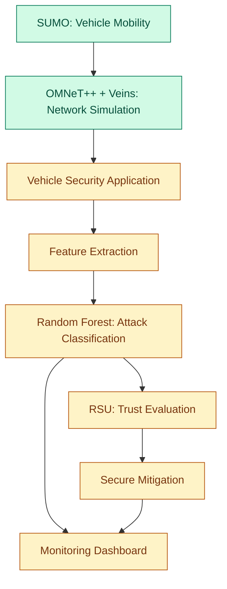

# ML-Based Multi-Attack Detection and Secure Mitigation in VANETs

An intelligent machine learning framework for detecting multiple cyberattacks in Vehicular Ad Hoc Networks (VANETs), with planned trust-based mitigation and real-time visualization.

## Overview

Vehicular Ad Hoc Networks (VANETs) enable vehicles to exchange information with nearby vehicles and Roadside Units (RSUs) to support intelligent transportation systems. However, these networks are vulnerable to attacks such as Denial of Service (DoS), Sybil attacks, Blackhole attacks, and false information dissemination.

This project aims to develop a machine learning-based security framework that analyzes vehicle behavior and network observations to identify malicious activity. The planned system integrates network simulation, attack detection, trust evaluation, mitigation, and visualization.

## Objectives

- Develop a machine learning pipeline for multi-class attack detection.
- Simulate vehicular mobility and communication using SUMO, OMNeT++, and Veins.
- Investigate detection of DoS, Sybil, Blackhole, and False Information attacks.
- Develop trust-based mechanisms to assess suspicious vehicles.
- Explore secure mitigation strategies through Roadside Units.
- Build a dashboard for visualizing network behavior and detection results.


## System Architecture



**Status note:** The diagram represents the intended architecture. The simulation configuration and synthetic-data Random Forest baseline exist, but the complete security pipeline has not yet been integrated. Update the diagram as components are implemented and tested.


The proposed workflow is:

1. **Vehicular Network Simulation:** Generate vehicle mobility and communication events.
2. **Feature Extraction:** Collect relevant vehicle behavior and network communication features.
3. **Attack Detection:** Apply machine learning to classify normal and suspicious behavior.
4. **Trust Evaluation:** Assess vehicle reliability using observed behavior.
5. **Secure Mitigation:** Investigate appropriate responses to detected malicious nodes.
6. **Visualization:** Present network activity, detected attacks, and mitigation results.

## Attack Classes

| Class | Description |
|---|---|
| Normal | Expected vehicle and communication behavior |
| DoS | Denial of Service |
| Sybil | One entity presenting multiple identities |
| Blackhole | Malicious behavior involving packet dropping or forwarding disruption |
| False Information | Dissemination of misleading or fabricated information |

## Technology Stack

- **Programming:** Python, C++
- **Machine Learning:** scikit-learn, Random Forest
- **Data Processing:** pandas, NumPy
- **Visualization:** Matplotlib; an interactive dashboard is planned
- **Network Simulation:** OMNeT++ 6.0.3, Veins 5.3.1
- **Mobility Simulation:** SUMO 1.12.0
- **Development Environment:** Ubuntu 22.04

## Current Implementation

The initial machine learning pipeline is implemented.

- Synthetic dataset generation for five classes.
- Eight illustrative input features.
- 5,000 synthetic records generated with a reproducible random seed.
- Stratified training and testing split: 4,000 training records and 1,000 testing records.
- Random Forest baseline classifier.
- Classification report, confusion matrix, and feature-importance output.

### Initial Baseline Results

The Random Forest achieved **100% accuracy on the synthetic test dataset**.

**Important:** This result is specific to the generated synthetic data. It does not demonstrate real-world VANET attack-detection performance. Evaluation on labelled, simulation-derived observations is still required.

## Repository Structure

```text
.
├── dataset/
│   └── generate_dataset.py
├── ml/
│   └── train_random_forest.py
├── simulation/
│   ├── config/
│   │   └── omnetpp.ini
│   ├── maps/
│   └── ned/
│       └── VANETSecurityScenario.ned
├── features/
├── attacks/
├── trust/
├── mitigation/
├── federated_learning/
├── dashboard/
├── results/
└── .gitignore
```

Generated datasets, trained model binaries, and evaluation outputs are excluded from Git by `.gitignore`.

## Setup

The following commands assume Python 3 and the required Python packages are installed.

Clone the repository:

```bash
git clone https://github.com/Arun-Gobalakichenan/ML-Based-Multi-Attack-Detection-and-Secure-Mitigation-in-VANETs-with-Real-Time-Visualiation.git

cd ML-Based-Multi-Attack-Detection-and-Secure-Mitigation-in-VANETs-with-Real-Time-Visualiation
```

Install the Python dependencies:

```bash
python3 -m pip install numpy pandas scikit-learn matplotlib joblib
```

Generate the synthetic dataset:

```bash
python3 dataset/generate_dataset.py
```

Train and evaluate the Random Forest baseline:

```bash
python3 ml/train_random_forest.py
```

The generated dataset, trained model, and evaluation outputs are stored locally in the directories specified by the scripts.

## Planned Development

- Implement project-owned vehicle security applications in Veins.
- Add controlled attack scenarios to the simulation.
- Export labelled observations from simulation runs.
- Evaluate and improve detection on simulation-derived data.
- Implement trust scoring and secure mitigation at RSUs.
- Develop a real-time visualization dashboard.
- Investigate federated learning as a potential extension.

## Limitations

The current classifier is a baseline evaluated using synthetic data. Its performance may not reflect realistic network conditions, attack behavior, mobility, or communication interference. The proposed attack simulation, trust mechanisms, mitigation, and dashboard should be considered works in progress until implemented and experimentally verified.

## Research Direction

The project investigates how machine learning and trust-based decision-making can improve security in vehicular networks while supporting detection of multiple attack types.

## Author

**Arun G**

Electronics and Communication Engineering  
Dayanand Sagar College of Engineering, Bengaluru, India

---

*This project is being developed for academic and research purposes.*
